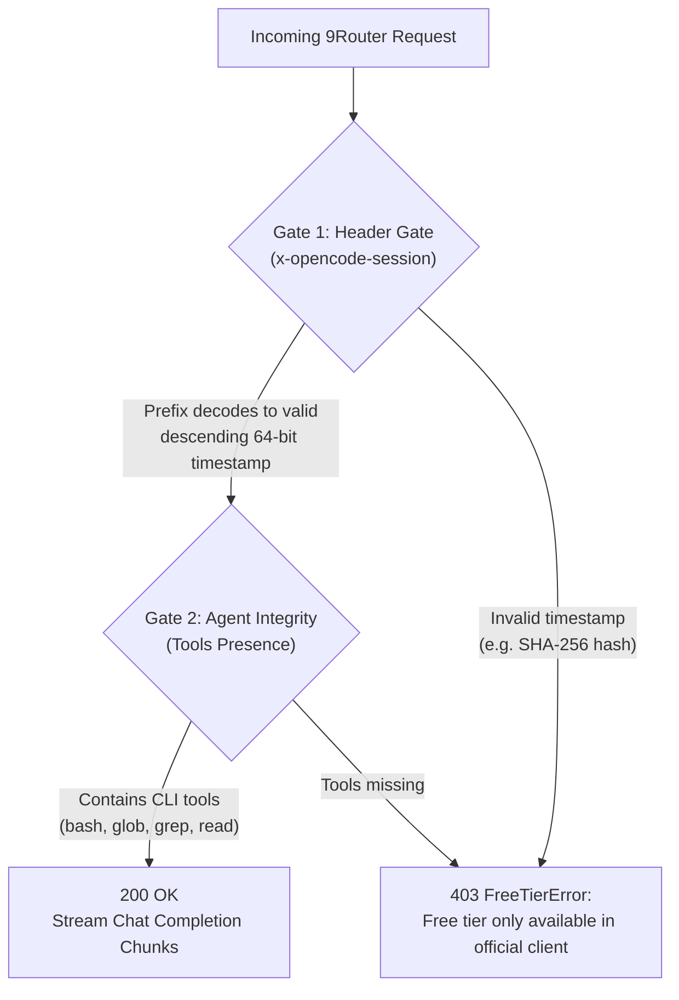

# 9Router OpenCode Zen Dual-Gate Standalone Hotfix

> [!NOTE]
> **REPOSITORY ARCHIVED & RESOLVED UPSTREAM**:  
> As of **9Router v0.5.104** (released October 2026), upstream 9Router has natively fixed the OpenCode Zen session timestamp calculation.  
> If you are on **9Router >= 0.5.104**, you **do not need this patch**—simply update 9Router (`npm update -g 9router` or `docker pull decolua/9router:latest`).  
> This repository is archived for historical reference and for environments running legacy versions (`v0.5.99` and earlier).

[](https://www.python.org/)
[](https://opensource.org/licenses/MIT)
[](https://github.com/9router/9router)
[](https://opencode.ai)

A universal, zero-dependency hotfix for [9Router](https://github.com/9router/9router) that restores full unblocked routing to **OpenCode Zen** free-tier models (`oc/*` and `ocz/*`), resolving upstream `403 FreeTierError: Free tier only available in official client` blocks.

Works across **any environment**: Windows, Linux, macOS, and Docker containers.

---

## Verified Tested Versions

| Component | Verified Version | Verification Context & Notes |
| :--- | :--- | :--- |
| **9Router** | `v0.5.99` | Tested & verified on bare-metal / npm global (Windows, Linux, macOS) and Docker containers. |
| **OpenCode CLI** | `v1.19.0` | Target client analyzed (`opencode.exe`) to reverse-engineer the Dual-Gate BigInt formulas (`x-opencode-session` descending timestamp and `x-opencode-request` ascending timestamp) and CLI agent tool contract. |

---

## The Problem

When sending chat completion requests to OpenCode Zen free-tier models (`oc/cat-jam-free`, `oc/deepseek-v4.1-flash-free`, `oc/beam-free`, `oc/space-bunny-free`, etc.) through 9Router, the upstream API immediately rejects the request with:

```json
{
  "error": {
    "message": "Free tier only available in official client",
    "type": "FreeTierError",
    "code": "free_tier_only"
  }
}
```

Even with valid authorization credentials, requests never reach the models.

---

## Root Cause Analysis

OpenCode Zen enforces a strict **Dual-Gate Protection Mechanism** to ensure requests originate from authentic clients:



### 1. The Header Gate (Timestamp BigInt Verification)
* **`x-opencode-session`**: The 12-hex-character prefix must decode to a **descending 64-bit millisecond timestamp**:
  $$\text{val} = \sim(4096n \times \text{timestamp\_ms} + 1n)$$
  followed by 14 random base62 characters (`[0-9A-Za-z]`).
* **`x-opencode-request`**: The 12-hex-character prefix must decode to an **ascending millisecond timestamp**:
  $$\text{val} = 4096n \times \text{timestamp\_ms} + 1n$$
  followed by 14 random base62 characters.

### 2. The 9Router Defect
In stock 9Router builds, session ID generation in `5330.js` and `6249.js` was implemented as a SHA-256 hash of the client connection ID:

```javascript
// BUG IN 9ROUTER:
let c = e().createHash("sha256").update(`opencode\0${b||"generic"}\0${a||""}`).digest();
let d = c.subarray(0, 6).toString("hex");
return `ses_${d}${f}`;
```

When OpenCode Zen decoded `d` as a BigInt millisecond timestamp, it evaluated to an impossible year (e.g. year 1970 or 35000), classified the request as third-party spoofed traffic, and returned **`403 FreeTierError`**.

---

## What This Hotfix Does

1. **Replaces Session Generator**: Swaps the broken SHA-256 hash with the authentic BigInt descending millisecond timestamp formula.
2. **Replaces Request Generator**: Restores the ascending timestamp generator (`A()`).
3. **Patches All Handler Variants**: Covers both `opencode` (`oc/*`) and `opencode-zen` (`ocz/*`) provider paths.
4. **Signature-Based Discovery**: Automatically locates the target chunk files by code signature rather than static file names, ensuring resilience across 9Router minor releases.
5. **Safety by Default**:
   - Creates automatic `.bak` backups before modifying any file.
   - Verifies JavaScript syntax via `node --check` prior to committing changes.
   - Automatically rolls back if syntax verification fails.

---

## Quick Start

### 1. Windows (Local npm Install)

#### Option A: One-Click Batch Launcher
Double-click `apply_patch.bat` or run:
```cmd
apply_patch.bat
```

#### Option B: PowerShell
```powershell
powershell -NoProfile -File apply_patch.ps1
```

#### Option C: Python CLI
```powershell
python patch_9router.py
```

---

### 2. Linux & macOS (Native npm Install)

```bash
# Make launcher executable
chmod +x patch.sh

# Run auto-detect and patch
./patch.sh

# Or run directly with Python 3
python3 patch_9router.py
```

---

### 3. Docker Deployments

If 9Router is running inside a Docker container:

```bash
# Patch container and auto-restart it
python3 patch_9router.py --docker <container_name_or_id>

# Example:
python3 patch_9router.py --docker 9router
```

The patcher will:
1. Locate the chunks inside the container via `docker exec`.
2. Create container-side backups (`.bak`).
3. Copy the chunks out, patch them, and verify syntax.
4. Copy the patched chunks back into the container.
5. Restart the container automatically.

---

## CLI Options Reference

```
usage: patch_9router.py [-h] [--path PATH] [--docker DOCKER] [--status]
                        [--rollback] [--dry-run] [--verify] [--url URL]
                        [--key KEY] [--model MODEL]

Options:
  -h, --help        Show this help message and exit
  --path PATH       Manual path to 9Router directory or chunks directory
  --docker DOCKER   Name or ID of Docker container running 9Router
  --status          Diagnose patch status of chunks without making changes
  --rollback        Restore all original chunks from .bak backups
  --dry-run         Preview changes without modifying any files
  --verify          Send a test completion probe to verify routing
  --url URL         API endpoint URL for verification (default: http://127.0.0.1:20128/v1/chat/completions)
  --key KEY         9Router API key for verification (or set ROUTER_API_KEY env var)
  --model MODEL     Model to query during verification (default: oc/mimo-v2.6-flash-free)
```

---

## Verification

After applying the patch, restart 9Router and test your endpoint:

```bash
# Verify local instance
python patch_9router.py --verify

# Verify remote or containerized instance with an API key
python patch_9router.py --verify --url http://127.0.0.1:20128/v1/chat/completions --key "your-9router-key"
```

A successful response outputs:
```
Verifying OpenCode Zen routing via: http://127.0.0.1:20128/v1/chat/completions
Testing model: oc/mimo-v2.6-flash-free
[SUCCESS] HTTP 200 OK in 4800ms
Model response: OK
OpenCode Zen Dual-Gate: UNBLOCKED and accepting requests!
```

---

## Rollback

To revert to the stock, unpatched files at any time:

```bash
python patch_9router.py --rollback
```

This restores all `.bak` copies and removes the backup artifacts.

---

## Verified Unblocked Models

| Model Identifier | Display Name | Capabilities | Speed |
| :--- | :--- | :--- | :--- |
| `oc/space-bunny-free` | **Space Bunny** | Fast reasoning, lightweight | ~60 tok/s |
| `oc/deepseek-v4.1-flash-free` | **DeepSeek V4.1 Flash** | Agentic workflows, coding | ~36 tok/s |
| `oc/cat-jam-free` | **Cat Jam** | Multimodal, coding, tools | ~26 tok/s |
| `oc/step-5-preview-free` | **Step 5 Preview** | Extended reasoning, tools | ~18 tok/s |
| `oc/mimo-v2.6-flash-free` | **Mimo v2.6 Flash** | 200K ctx, Multimodal, Math/Coding | ~14 tok/s |
| `oc/nemotron-3.5-lightning-free` | **Nemotron 3.5 Lightning** | High-throughput reasoning | ~60 tok/s |
| `oc/big-pickle` | **Big Pickle** | Deep reasoning, tool calling | ~17 tok/s |
| `oc/longcat-2.5-preview-free` | **LongCat 2.5 Preview** | Long context reasoning | ~15 tok/s |

---

## License

This project is licensed under the [MIT License](LICENSE).
